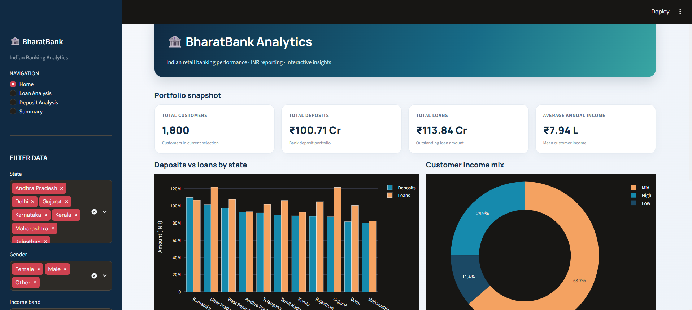
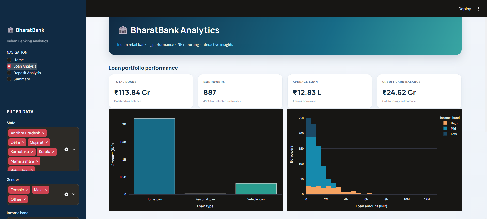
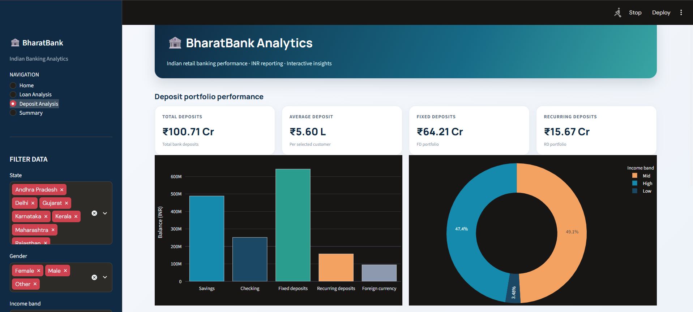
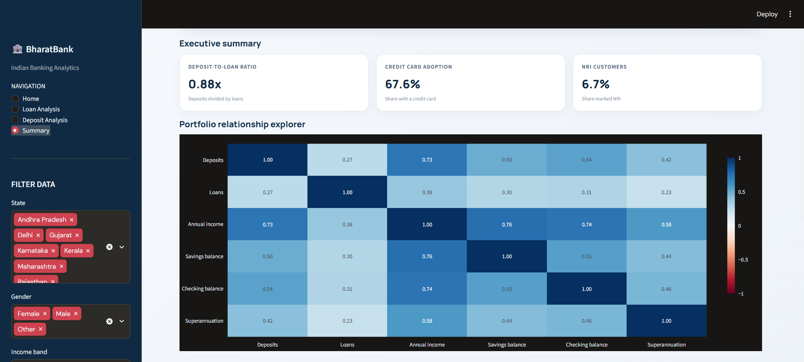

# BharatBank Analytics 🇮🇳
### Indian Banking Analytics Dashboard

An interactive banking analytics project built using **Python, SQL, MySQL, and Streamlit**, focused on exploring customer demographics, deposits, loans, and financial patterns in the Indian banking context.

## Live Dashboard

[**Open BharatBank Analytics Dashboard**](https://p0cd3nzt-8501.inc1.devtunnels.ms/)

## Dashboard Preview



## Key Features

- **Interactive Dashboard:** Explore banking data through interactive charts and filters.
- **Customer Analysis:** Analyze customers by age, gender, state, and income segment.
- **Loan Analysis:** Examine loan distribution, borrowing patterns, and loan products.
- **Deposit Analysis:** Analyze savings, checking accounts, fixed deposits, and recurring deposits.
- **Financial Insights:** Track deposits, loans, balances, and customer income segments.
- **Data Export:** Download filtered customer records as CSV.

## Dashboard Screenshots

### 1. Home Dashboard
Overview of customer demographics, financial KPIs, and regional banking patterns.


### 2. Loan Analysis
Explore loan portfolios, borrower distribution, and loan-related insights.



### 3. Deposit Analysis
Visualize deposit products and customer deposit patterns.



### 4. Summary & Customer Insights
Explore customer-level information, income segments, and analytical summaries.



## Tech Stack

| Technology | Purpose |
|---|---|
| Python | Data processing and analysis |
| Pandas & NumPy | Data cleaning and manipulation |
| Streamlit | Interactive dashboard |
| Plotly | Data visualization |
| MySQL | Database management |
| SQL | Analytical queries |
| Power BI | Starter DAX measures and report theme |

## Project Structure

```text
BharatBank-Analytics/
│
├── data/
│   └── indian_banking_customers.csv
│
├── analysis/
│   ├── clean_data.py
│   ├── exploratory_analysis.py
│   └── outputs/
│
├── sql/
│   └── banking_analysis.sql
│
├── power_bi/
│   ├── measures.dax
│   └── bharatbank_theme.json
│
├── screenshots/
│   ├── home_dashboard.png
│   ├── loan_analysis.png
│   ├── deposit_analysis.png
│   └── summary_dashboard.png
│
├── app.py
├── requirements.txt
└── README.md
```

## Run Locally

**Prerequisites:** Python 3.10 or newer.

1. Clone the repository:

```bash
git clone https://github.com/Neha-adepu-2510/BharatBank-Analytics.git
```

2. Navigate to the project folder:

```bash
cd BharatBank-Analytics
```

3. Create and activate a virtual environment:

```bash
python -m venv .venv
.venv\Scripts\activate
```

4. Install dependencies:

```bash
pip install -r requirements.txt
```

5. Run the dashboard:

```bash
streamlit run app.py
```

Open `http://localhost:8501` in your browser.

## Data Disclaimer

This project uses a **synthetic dataset of 1,800 Indian banking customers**, created exclusively for demonstration and educational purposes.

It does not contain actual bank or customer information. Income segments are project-defined analytical categories, not official regulatory or tax classifications. All monetary values are represented in Indian Rupees (INR).

## Author

**Neha Adepu**

B.Tech – Computer Science and Engineering (AI & ML)

- [GitHub](https://github.com/Neha-adepu-2510)
- [LinkedIn](https://linkedin.com/in/neha-adepu-n1h007/)

---

*BharatBank Analytics – Exploring Indian Banking Data Through Analytics.*